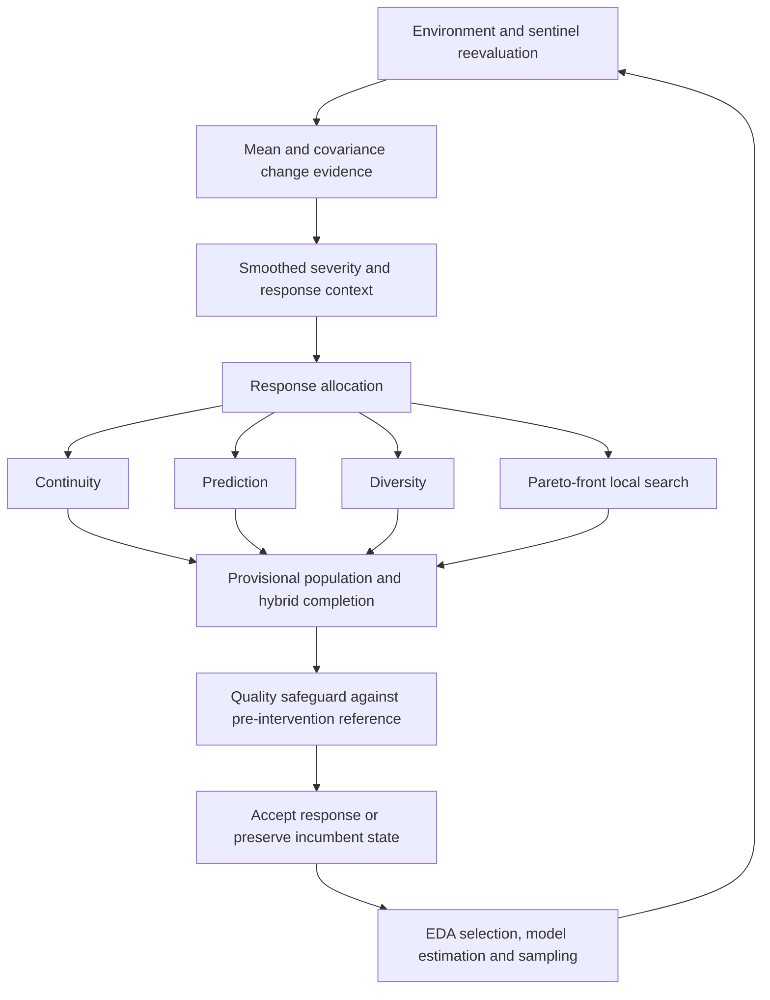

# ADR-EDA

Adaptive Dynamic Response Estimation of Distribution Algorithm is an adaptive
control architecture for dynamic multiobjective optimization. It decides how
much inherited optimizer state should be retained, corrected or replaced after
environmental change.

Dynamic multiobjective optimization · probabilistic models · adaptive response · shared mobility

## What it does

**How much should the optimizer trust inherited state after the environment changes?**
Blind reuse risks negative transfer; restarting discards useful information.
ADR-EDA controls a persistent multiobjective Estimation of Distribution
Algorithm (EDA), retaining population, elites, a bounded archive and
probabilistic-model state: `S_t = (P_t, E_t, A_t, theta_t)`.

Sentinel reevaluation separates mean displacement (a Hotelling-T2-like
statistic) from covariance/dependence change (Stein divergence). Regularization,
EWMA smoothing, threshold ratios and persistence/cooldown/separation logic
turn this evidence into severity and response context.



The evaluated backend is SPEDA / SPBN. Nondominated sorting and crowding-style
selection support multiobjective optimization; the search learns and samples a
probabilistic model. The public configuration is
[`ADR_EDA_PROFILE`](src/adr_eda/profile.py); the characterized core is reconstructed
from the [EDAspy extension](external/edaspy_extension/README.md).

## Benchmark and results

The evaluated protocol uses **14 problems × 15 seeds**, horizon **60**, population
**40**, **8** decision variables and **1** generation per dynamic step: eight
established dynamic problems and six DF-T10 problems.

ADR-EDA achieved the best mean global MIGD and MHV among the compared methods
under this protocol, while Tr-NSGA-II showed better immediate post-change IGD.
Selected means from the [final benchmark table](docs/benchmark_results/final_thesis_pack_2026_06_28/benchmark/analysis/overall_table.csv):

| Method | MIGD ↓ | MHV ↑ | Post-change IGD ↓ | Post-change HV ↑ | Runtime (s) ↓ |
| --- | ---: | ---: | ---: | ---: | ---: |
| ADR-EDA | **0.3748** | **5.3607** | 0.2780 | 4.5904 | 204.3 |
| SGEA | 0.6829 | 5.1786 | 0.9610 | 4.4672 | 7.6 |
| Tr-NSGA-II | 0.6112 | 4.7203 | **0.2192** | **4.5953** | 28.6 |
| DNSGA-II-B | 1.1113 | 4.9528 | 1.5801 | 4.3584 | 23.8 |

MIGD/MHV summarize tracking across the dynamic horizon. ADR-EDA's standard
deviations are 0.6824 (MIGD), 3.5307 (MHV), 0.5266 (post-change IGD),
4.4231 (post-change HV) and 116.7 s (runtime). These aggregate results do not
imply a win on every problem: ADR-EDA has 6/14 MIGD and 7/14 MHV wins.
Its computational cost is substantially higher. The supplied paired comparison
with Tr-NSGA-II gives worse post-change IGD for ADR-EDA (p = 8.85e-04), with no
significant difference in post-change HV (p = 0.1450) or recovery (p = 0.9570).
See [evidence and interpretation](docs/RESULTS.md) for provenance and limitations.

The chunked launcher includes ADR-EDA, DNSGA-II-B, MNSGA-II, SGEA, Tr-NSGA-II,
PFPA, TDA-DMOEA and AB-DMOEA. The final consolidated comparison additionally
includes [ADR-DMOEA](docs/benchmark_results/final_thesis_pack_2026_06_28/benchmark_adr_dmoea/REPORT.md)
(MIGD 1.0066; MHV 4.1112), evaluated separately. The launcher does not reproduce
that ninth algorithm. Comparators are implementations/ports within a common
runner; some receive change notifications while ADR-EDA uses its detector.

## Shared-mobility case studies

These are research simulations, with consolidated evidence in [results](docs/RESULTS.md).

- **Electric free-floating car sharing:** over six runs of the controlled
  eight-hour study, ADR-EDA improves mean margin by €503.55 and reduces
  unproductive travel by 136.23 km and reoptimizations by 91 versus full static
  replanning, with a service decrease of 0.301 percentage points.
- **RealCar-Munich:** real-demand transfer in compact simulations. Results vary
  with horizon and zone count; the final package records both service gains
  and service tradeoffs.
- **Citi Bike / Divvy:** over 336 hours, ADR-EDA serves 99.56% / 89.60% of demand
  with 146.1 / 183.1 reoptimizations, versus 336 for hourly EDA. Relocation
  distance is higher than hourly EDA, despite the reduction in updates.

Limitations include simplified rebalancing, representative routing/distances,
no live traffic, no strategic user behavior and no operator deployment.
Raw third-party demand datasets are not included.

## Quick start

Install Docker Desktop, or Docker Engine with Compose, then run:

```bash
git clone https://github.com/samugc/ADR-EDA.git
cd ADR-EDA
./scripts/setup.sh
./scripts/run_benchmark.sh
```

The first build may take several minutes. Docker reconstructs the patched
EDAspy backend automatically on `linux/amd64`, including on Apple Silicon.
The default run evaluates ADR-EDA on `df1_t10`, seed 0, and writes to
`results/benchmark/`. Use `./scripts/run_benchmark.sh --help` for options.

## Full benchmark

```bash
./scripts/run_full_benchmark.sh
```

Runs the eight-method, 14-problem, 15-seed protocol in resumable chunks under
`results/full_benchmark/`. Rerun the same command to resume successful chunks;
use a new output directory for a different protocol. This is a long campaign.
See [reproducibility](REPRODUCIBILITY.md) for collection and output details.

## Repository structure

| Path | Purpose |
| --- | --- |
| `src/adr_eda/` | Canonical public configuration |
| `external/edaspy_extension/` | Pinned upstream identity and required core patch |
| `docker/` | Canonical benchmark runtime |
| `scripts/` | Public benchmark entry points and application tools |
| `tests/edas/` | Characterized benchmark runner and historical scientific code |
| `src/free_floating_robust/`, `tests/model/` | Mobility model and applied validation |
| `docs/` | Consolidated scientific evidence and runtime provenance |

## Reproducibility

[REPRODUCIBILITY.md](REPRODUCIBILITY.md) documents setup, protocol and scope.
The [runtime characterization](docs/reproducibility/CHARACTERIZATION.md) matched
all recorded outputs except wall-clock runtime for one `df1_t10` case against
the historical environment. It is evidence for that case, not every experiment.
The quality safeguard was enabled with no reverts; actual front-local-search
sampling was not exercised in that run.

Historical artifact names and validated code remain intact for traceability.
Licensing is unresolved at repository level; consult
[third-party provenance](THIRD_PARTY.md) before reuse or redistribution.

## Research background and citation

Associated paper: **ADR-EDA: A reliability-aware controller for dynamic
multiobjective estimation of distribution algorithms**, accepted at CAEPIA 2026
/ Springer proceedings. DOI and final proceedings metadata are not supplied.

Associated Master's thesis: *ADR-EDA: una arquitectura adaptativa de estimación
de distribuciones para optimización multiobjetivo dinámica con aplicaciones en
movilidad compartida*, by **Jesús Samuel García Carballo**, supervised by
**Concha Bielza Lozoya** and **Pedro Larrañaga Múgica**.

Use [CITATION.cff](CITATION.cff) to cite the software; cite the associated
research where appropriate. No unverified publication identifiers are assigned.
