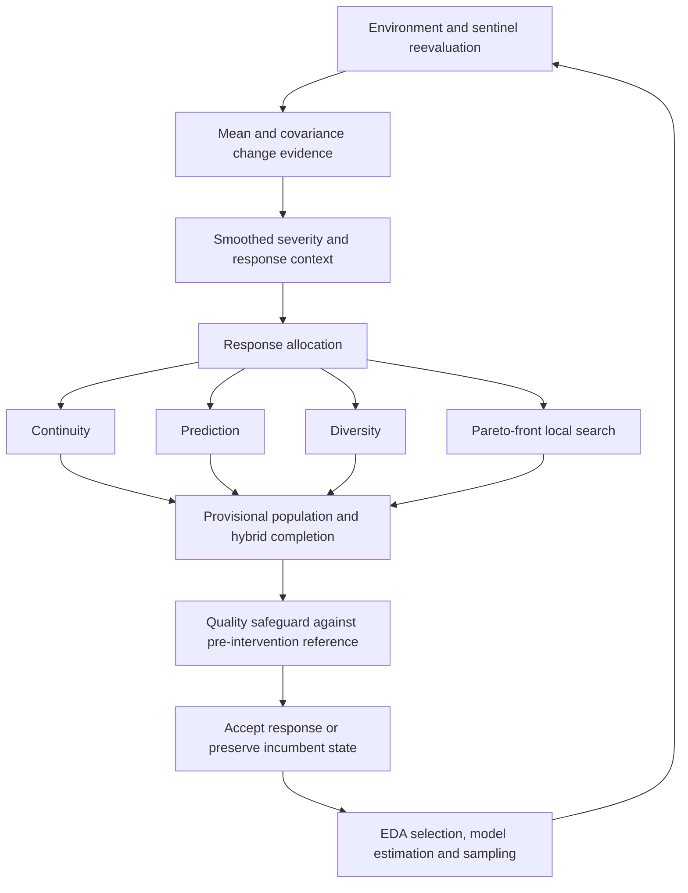

# ADR-EDA

Adaptive Dynamic Response Estimation of Distribution Algorithm is a research implementation for **dynamic multiobjective optimization**. It controls how much optimizer state should be retained, corrected or replaced after an environmental change.

Associated research: **ADR-EDA: A reliability-aware controller for dynamic multiobjective estimation of distribution algorithms**, accepted at **CAEPIA 2026 / Springer proceedings**.

Dynamic multiobjective optimization · probabilistic models · adaptive response · shared mobility

## Results at a glance

The evaluated benchmark uses **14 problems × 15 seeds**, horizon **60**, population **40**, **8** decision variables and **1** generation per dynamic step.

| Method | MIGD ↓ | MHV ↑ | Post-change IGD ↓ | Runtime (s) ↓ |
| --- | ---: | ---: | ---: | ---: |
| ADR-EDA | **0.3748** | **5.3607** | 0.2780 | 204.3 |
| SGEA | 0.6829 | 5.1786 | 0.9610 | 7.6 |
| Tr-NSGA-II | 0.6112 | 4.7203 | **0.2192** | 28.6 |
| DNSGA-II-B | 1.1113 | 4.9528 | 1.5801 | 23.8 |

ADR-EDA achieved the best mean global MIGD and MHV among the compared methods under this protocol, while Tr-NSGA-II showed better immediate post-change IGD. ADR-EDA also had substantially higher computational cost. These results describe this evaluated protocol, not universal superiority.

[Full benchmark results and statistical analysis](docs/RESULTS.md)

## What it does

**How much should the optimizer trust inherited state after the environment changes?**
Blind reuse risks negative transfer; restarting discards useful information.
ADR-EDA controls a persistent multiobjective Estimation of Distribution
Algorithm (EDA), retaining population, elites, a bounded archive and
probabilistic-model state: `S_t = (P_t, E_t, A_t, theta_t)`.

Change detection separates mean displacement from covariance changes. The
controller estimates severity, allocates a response and checks its quality
before continuing model learning and sampling.



The evaluated backend is SPEDA / SPBN. Nondominated sorting and crowding-style
selection support multiobjective optimization; the search learns and samples a
probabilistic model. The public configuration is
[`ADR_EDA_PROFILE`](src/adr_eda/profile.py); the characterized core is reconstructed
from the [EDAspy extension](external/edaspy_extension/README.md).

## Benchmark and results

The evaluated protocol uses **14 problems × 15 seeds**, horizon **60**, population
**40**, **8** decision variables and **1** generation per dynamic step: eight
established dynamic problems and six DF-T10 problems.

ADR-EDA achieved the best mean global MIGD and MHV among the compared methods
under this protocol, while Tr-NSGA-II showed better immediate post-change IGD.
Selected means from the [final benchmark table](docs/benchmark_results/final_thesis_pack_2026_06_28/benchmark/analysis/overall_table.csv):

| Method | MIGD ↓ | MHV ↑ | Post-change IGD ↓ | Post-change HV ↑ | Runtime (s) ↓ |
| --- | ---: | ---: | ---: | ---: | ---: |
| ADR-EDA | **0.3748** | **5.3607** | 0.2780 | 4.5904 | 204.3 |
| SGEA | 0.6829 | 5.1786 | 0.9610 | 4.4672 | 7.6 |
| Tr-NSGA-II | 0.6112 | 4.7203 | **0.2192** | **4.5953** | 28.6 |
| DNSGA-II-B | 1.1113 | 4.9528 | 1.5801 | 4.3584 | 23.8 |

ADR-EDA wins 6/14 problems on MIGD and 7/14 on MHV, with substantially higher
computational cost. These are results under the evaluated protocol, not a
claim of universal superiority. [Full results and statistical analysis](docs/RESULTS.md)
include all nine compared methods, uncertainty and post-change tradeoffs.

## Shared-mobility case studies

- **Electric car sharing:** improved margin and fewer reoptimizations, with a
  small service tradeoff in the controlled study.
- **RealCar-Munich:** transfer experiments using real demand in compact simulations.
- **Citi Bike / Divvy:** maintained competitive service with fewer full updates;
  relocation distance was higher than hourly EDA.

These are simulations, not operator deployments. See [case-study results](docs/RESULTS.md)
for final metrics, comparisons and limitations. Raw demand datasets are not included.

## Quick start

Install Docker Desktop, or Docker Engine with Compose, then run:

```bash
git clone https://github.com/samugc/ADR-EDA.git
cd ADR-EDA
./scripts/setup.sh
./scripts/run_benchmark.sh
```

The first build may take several minutes. Docker reconstructs the patched
EDAspy backend automatically on `linux/amd64`, including on Apple Silicon.
The default run evaluates ADR-EDA on `df1_t10`, seed 0, and writes to
`results/benchmark/`. Use `./scripts/run_benchmark.sh --help` for options.

## Full benchmark

```bash
./scripts/run_full_benchmark.sh
```

Runs the eight-method, 14-problem, 15-seed protocol in resumable chunks under
`results/full_benchmark/`. Rerun the same command to resume successful chunks;
use a new output directory for a different protocol. This is a long campaign.
ADR-DMOEA was evaluated separately and is not included in this launcher.
See [reproducibility](REPRODUCIBILITY.md) for collection and output details.

## Repository structure

| Path | Purpose |
| --- | --- |
| `src/adr_eda/` | Canonical public configuration |
| `external/edaspy_extension/` | EDAspy extension |
| `docker/` | Canonical benchmark runtime |
| `scripts/` | Public benchmark entry points and application tools |
| `tests/edas/` | Benchmark runner and validation |
| `src/free_floating_robust/`, `tests/model/` | Mobility model and applied validation |
| `docs/` | Results and reproducibility |

## Reproducibility

[Setup and reproducibility](REPRODUCIBILITY.md) describes the Docker workflow.
A [runtime comparison](docs/reproducibility/CHARACTERIZATION.md) matched recorded
outputs except timing on one benchmark case; full experimental coverage is not implied.
See [third-party provenance](THIRD_PARTY.md) for the unresolved repository license.

## Research background and citation

Associated paper: **ADR-EDA: A reliability-aware controller for dynamic
multiobjective estimation of distribution algorithms**, accepted at CAEPIA 2026
/ Springer proceedings.

Associated Master's thesis: *ADR-EDA: una arquitectura adaptativa de estimación
de distribuciones para optimización multiobjetivo dinámica con aplicaciones en
movilidad compartida*, by **Jesús Samuel García Carballo**, supervised by
**Concha Bielza Lozoya** and **Pedro Larrañaga Múgica**.

Use [CITATION.cff](CITATION.cff) to cite the software; cite the associated
research where appropriate.
